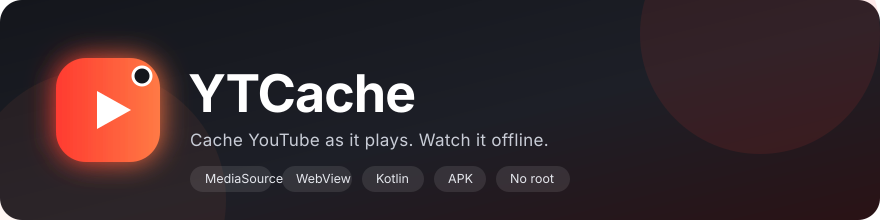
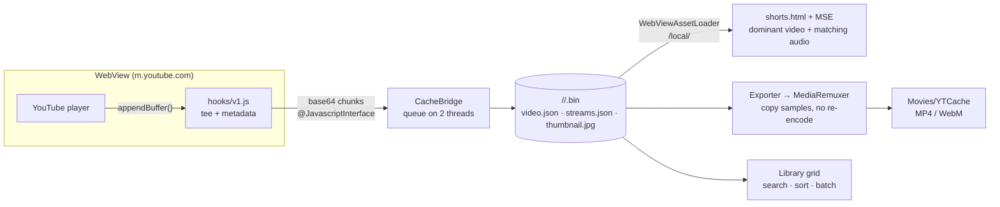

<div align="center">



# YTCache

**An Android app that caches a YouTube video while it plays, then replays it offline — full-screen, swipeable, with the video's real length on the seek bar.**

[](https://github.com/ampl0/YTCache/releases/latest)
[](https://github.com/ampl0/YTCache/releases)
[-3DDC84?logo=android&logoColor=white)](#requirements)
[](https://kotlinlang.org)
[](#requirements)
[](LICENSE)

[**Download the APK**](https://github.com/ampl0/YTCache/releases/latest) · [Documentation](docs/README.md) · [How it works](docs/ARCHITECTURE.md) · [Build from source](docs/BUILD.md) · [For AI agents](docs/AI-AGENT-GUIDE.md)

</div>

---

## What it is

YTCache is not a downloader that scrapes video URLs. It is a **capture** app: it embeds
`m.youtube.com` in a WebView, taps the player's own `SourceBuffer.appendBuffer` calls, and
keeps a byte-exact copy of the media segments the player already received. Those same bytes
are later fed back into Media Source Extensions in a local player, so playback matches exactly
what the device could already decode — no transcoding, no re-encode, no external service, no root.

Because the capture is the player's own stream, it contains the **video and audio tracks
separately** in their original codecs (AV1 / VP9 + Opus, or H.264 / AAC), plus the metadata that
was on screen at capture time: title, channel, duration, description and thumbnail.

<table>
<tr><td width="50%" valign="top">

**Capture**
- One tap arms the recorder; the currently playing video is cached as it streams
- Video + audio tracks captured independently, byte-exact
- Metadata and thumbnail saved at capture time — offline stays offline
- Floating status pill: streams, bytes, save progress
- Works from any point in a video; the player shows which window you own

</td><td width="50%" valign="top">

**Watch offline**
- Shorts-style vertical feed, one video per screen, previous page pauses itself
- Seek bar shows the **real duration**; the cached window is the grey band
- Auto-aligns to the first cached frame, or resumes your last position
- YouTube-style chrome fades after ~2.6 s, tap to bring it back
- Mute toggle, tap-for-sound gate, per-video description and copy-link

</td></tr>
<tr><td valign="top">

**Library**
- Two-column grid with thumbnails, channel, duration, capture date, size
- Search by title or channel, sort newest / oldest / largest / A–Z
- Long-press to multi-select: batch export or batch delete
- Partial captures are badged so nothing looks like a full download

</td><td valign="top">

**Export**
- Lossless remux to **MP4 or WebM** with audio when the codec pair is legal
- Audio-only export for podcast-style saves
- Falls back to a silent video with an honest reason when the pair cannot be muxed
- Files land in `Movies/YTCache` through MediaStore

</td></tr>
</table>

## How it works



1. **Hook.** A document-start script wraps `MediaSource.addSourceBuffer` and
   `SourceBuffer.appendBuffer`. Every fragment gets a stream key (`s3-video`, `s4-audio`),
   a sequence number and a mime, then travels to native as one base64 message.
2. **Store.** Fragments are written atomically (`<seq>.bin.tmp` → `<seq>.bin`) under
   `Android/data/com.ytcache.app/files/YTCache/<videoId>/`, one directory per stream,
   with the container sniffed from the init segment rather than trusted from the page.
3. **Play.** The player picks the dominant (largest) video stream plus its matching audio
   stream, reads the fragments through a local asset loader, and appends them into two
   `SourceBuffer`s. It never re-muxes to play, which is why codecs always work.
4. **Export.** `MediaExtractor` + `MediaMuxer` copy the samples into a single indexed
   container — fast and lossless — only when the codec pair is legal for that container.

The long version, with the wire format and the playback maths, is in
[docs/ARCHITECTURE.md](docs/ARCHITECTURE.md).

## Install

### From the release page (recommended)

1. Open [**Releases → YTCache 1.2.0**](https://github.com/ampl0/YTCache/releases/latest).
2. Download `YTCache-1.2.0-release.apk`.
3. Allow installation from your browser/file manager when prompted, then open **YTCache**.

Or over USB:

```bash
adb install -r YTCache-1.2.0-release.apk
```

The release APK is signed with the project key (`CN=YTCache`), `minSdk 26` (Android 8.0),
`targetSdk 34`, package `com.ytcache.app`. SHA-256 checksums are published in every release
note, so you can verify the download:

```bash
sha256sum YTCache-1.2.0-release.apk
```

The `debug` APK on the same release is the same code signed with the debug key — use it only
if a device refuses the release signature (uninstall the other build first; the signatures differ).

### Requirements

| | |
|---|---|
| Android | 8.0 Oreo (API 26) or newer, arm64 recommended |
| WebView | a current Android System WebView (AV1/VP9 support follows the device) |
| Root | not required — everything lives in app-specific storage |
| Network | only for browsing YouTube and caching; playback is fully offline |

## Use it

1. **Browse.** The app opens YouTube. Find a video and start playing it.
2. **Cache.** Tap **Cache** before or during playback. The pill shows
   `title · 2 streams · 34.2 MB` and keeps updating. Segments captured before you tap are not
   included — the app records from the moment you arm it.
3. **Stop.** Tap **Stop** (or leave the video). The capture is saved and appears in the library.
4. **Watch.** **Library → tap a video.** Swipe up/down for the next one. The seek bar is the
   video's real length; the grey band is what is cached; tapping outside the band jumps to the
   nearest cached frame and tells you the window.
5. **Export.** In the player, tap **Export**. Choose *Export with sound* (MP4/WebM) or
   *Export audio only*. Files appear in `Movies/YTCache` and in your gallery/music apps.
6. **Manage.** Long-press a card to select several, then batch export or delete. Search and
   sort live in the library toolbar.

Settings (top-right on the browse screen): show/hide the floating capture pill, and play
offline videos with sound by default.

## Build from source

```bash
git clone https://github.com/ampl0/YTCache.git
cd YTCache
bash scripts/setup-env.sh          # JDK 17, Android SDK 34, Gradle 8.7, dev keystore
./gradlew test assembleDebug       # 57 JVM tests + debug APK
./gradlew assembleRelease          # signed release APK
```

Full prerequisites, signing notes, APK verification and troubleshooting:
[docs/BUILD.md](docs/BUILD.md).

Test suites that ship with the repo:

```bash
node tools/test-core.js   # 19 checks — stream picking, mime candidates, formatting
node tools/test-hook.js   # 19 checks — capture hook against a mocked MSE + bridge
./gradlew test            # 57 JVM tests — storage, framing, sniffing, mux planning
```

## Documentation

| Document | What is in it |
|---|---|
| [docs/ARCHITECTURE.md](docs/ARCHITECTURE.md) | Components, capture wire format, storage layout, playback timeline maths, export planner |
| [docs/IDEA-AND-PROCESS.md](docs/IDEA-AND-PROCESS.md) | The idea, the wrong turns, and how the design got here — release by release |
| [docs/AI-AGENT-GUIDE.md](docs/AI-AGENT-GUIDE.md) | A reproduction blueprint for an AI agent: phases, invariants, pitfalls, acceptance checks |
| [docs/BUILD.md](docs/BUILD.md) | Toolchain, build/test commands, signing, verification, environment troubleshooting |
| [docs/USAGE.md](docs/USAGE.md) | User manual, limits, FAQ and troubleshooting |
| [docs/CHANGELOG.md](docs/CHANGELOG.md) | Version history |
| [YTCache_HANDOFF.md](YTCache_HANDOFF.md) | The original engineering handoff this project was built from |

## Repository layout

```
app/src/main/
  assets/hooks/v1.js          capture hook: MSE tee + metadata extraction
  assets/hooks/back.js        back-navigation bridge (pushState depth)
  assets/player/shorts.html   offline player shell
  assets/player/player.js     player: MSE append, timeline, chrome, gestures
  assets/player/ytc-core.js   pure helpers (sniffing, stream picking, time format)
  assets/player/style.css     player UI
  java/com/ytcache/app/
    MainActivity.kt           WebView host, capture toggle, back dispatcher
    LibraryActivity.kt        grid, search, sort, batch actions
    PlayerActivity.kt         player host + asset loader
    CacheBridge.kt            JS bridge, metadata, export/delete entry points
    Exporter.kt               export orchestration + MediaStore
    MediaRemuxer.kt           lossless sample copy into MP4/WebM
    data/                     storage, session, queue, sniffer, mux planner, picker
  res/                        layouts, drawables, strings, theme
app/src/test/                 57 JVM tests
tools/                        Node test harnesses for the JS hook and core
scripts/setup-env.sh          reproducible toolchain bootstrap
docs/                         this documentation set
artifacts/                    build output (APKs are attached to Releases, not committed)
```

## Limits, honestly

- **Only what plays gets cached.** Capture is a tee on the player's own buffers. Segments
  before you tap *Cache* are gone; seeking ahead in a long video only captures what the player
  actually fetched.
- **Mid-stream starts can be unplayable.** MSE needs an init segment. If a capture begins after
  the player initialised, there is nothing to start from and the player says so instead of
  pretending. Start caching from the beginning for a clean file.
- **No background downloader.** The capture runs in the browse screen. There is no foreground
  service, so don't switch away expecting the cache to continue.
- **Codec support is the device's.** Playback uses the same WebView codecs that played it
  online. A device that cannot decode AV1 cannot play an AV1 capture.
- **Export cannot invent codecs.** MP4 accepts H.264/H.265/AV1 + AAC; WebM accepts
  VP8/VP9/AV1 + Opus/Vorbis. When the pair is not legal for either container, the app exports
  the video alone and tells you why. Nothing is ever transcoded.
- **No DRM, no private content.** Protected streams never reach `appendBuffer` in a usable form.
- **Tested by compilation, unit tests and JS harnesses — not on physical hardware in this
  repository's build environment.** Timeline behaviour, chrome fades and the back gesture
  follow documented WebView/MediaSource semantics, but treat device-specific playback as
  something to verify on your phone. Bug reports with `adb logcat -s YTCacheMain YTCachePlayer`
  are very welcome.

## FAQ

**Where are the files?** In `Android/data/com.ytcache.app/files/YTCache/`, app-specific external
storage. They are intentionally not in `Downloads`; use **Export** for a normal media file.

**Why does the seek bar show 42:10 when I cached two minutes?** Because the bar is the video's
real duration, not the capture's. The grey band marks the part you actually own, and seeking
outside it snaps to the nearest cached frame.

**Can I cache a whole 2-hour video?** You can cache as much as you let it play, and YouTube
buffers ahead, so a paused long video keeps filling for a while. The app tells you the window it
holds; there is no "download the rest" button, by design.

**Why base64 over the bridge?** It is the transport Chrome never drops or reorders. The
ArrayBuffer `WebMessageListener` path exists but base64 via `@JavascriptInterface` is the
reliable default; writes happen on a background queue so YouTube's UI stays responsive.

**Can I use it with another site?** The hook is generic MSE capture; the metadata reader and the
URL handling are YouTube-specific. See [docs/AI-AGENT-GUIDE.md](docs/AI-AGENT-GUIDE.md) for the
extension points.

## Intended use

YTCache is a personal, offline-shifting tool for content you are allowed to watch: your own
uploads, Creative Commons material, or videos you have permission to keep. It circumvents no
DRM and bypasses no paywall. Downloading copyrighted video can violate YouTube's Terms of
Service and local copyright law — that is on the person pressing the button. The authors ship
source code, not content, and take no responsibility for misuse.

## Contributing

Issues and pull requests are welcome. Useful reports include the Android version, device,
WebView version, the video URL, what you expected, and the logcat lines above. If you touch
`hooks/v1.js`, run `node tools/test-hook.js`; if you touch `ytc-core.js` or `player.js`, run
`node tools/test-core.js` and `./gradlew test` first. `keystore/`, `local.properties` and
`artifacts/*.apk` are intentionally untracked.

## Keywords

`android` · `kotlin` · `youtube` · `offline` · `offline-video` · `mediasource` · `mse` ·
`webview` · `media-capture` · `video-player` · `shorts` · `apk` · `fmp4` · `webm` · `av1` ·
`vp9` · `opus` · `media-remuxer` · `jetpack` · `gradle` · `no-root` · `android-app` ·
`video-cache` · `local-first`

## License

[MIT](LICENSE) © 2026 ampl0. Not affiliated with, endorsed by, or supported by YouTube or Google.
